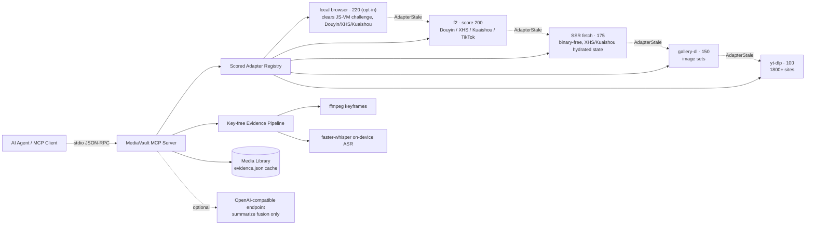

# 🗄️ MediaVault MCP

**[English](README.md)** ｜ **[简体中文](README.zh-CN.md)**

[](https://github.com/Majiturbo/mediavault-mcp/actions/workflows/ci.yml)
[](https://github.com/Majiturbo/mediavault-mcp)
[](https://www.python.org/)
[](https://modelcontextprotocol.io/)
[](LICENSE)
[](CONTRIBUTING.md)

> **Paste a link, get the original.** A local, key-free stdio MCP server that
> pulls native no-watermark media from 1800+ platforms and hands your AI agent
> real video evidence — transcript plus keyframe images — without ever calling
> a second LLM.

Your agent already has a model. Why should a media MCP demand another API key?
MediaVault collects deterministic evidence on your machine
(yt-dlp / f2 / gallery-dl → ffmpeg → local Whisper) and returns it as MCP
content blocks, so **the agent you already run does the reasoning**. An
optional server-side summary fusion is there if you want it, but it is never
required.

## ✨ Why MediaVault?

- 🔑 **Zero required API keys.** `parse_url`, `download` and `analyze` work with no key and never call a third-party model. Speech is transcribed on-device with faster-whisper; frames come back as image blocks for the agent's own vision.
- 🛡️ **Honest no-watermark claims.** We fetch the platform's own source stream and report `native` / `unknown` / `none` per item. No cropping, no inpainting, no pretending a watermark was removed.
- 🔗 **Scored adapter fallback chain.** f2 (CN-first) → gallery-dl (image sets) → yt-dlp (1800+ sites). A stale extractor degrades transparently instead of failing the request.
- 🧠 **Agent-native video understanding.** One `analyze` call returns a JSON evidence block (caption, timestamped transcript, pipeline status) **plus one image content block per keyframe** — exactly what a vision-capable agent needs.
- 📚 **Persistent media library.** Every result is atomically cached per video; repeat calls skip re-downloading and re-transcribing, with `refresh=true` to force a fresh run.
- 🔒 **Local-first and private.** Cookies and proxies stay on your machine, are validated before use, and never appear in logs or cached evidence.

## 🧩 How it works



The MCP surface never changes when a platform shifts: only the adapter behind
the registry does, and `AdapterStale` automatically walks the chain.

## 🚀 Quick start

Requires Python 3.11+, [uv](https://docs.astral.sh/uv/), and ffmpeg
(`brew install ffmpeg` on macOS, or your distro's package).

```bash
git clone https://github.com/Majiturbo/mediavault-mcp.git
cd mediavault-mcp
uv venv --python 3.11
uv pip install -e ".[dev]"
uv pip install -e ".[local-asr]"   # optional: fully offline speech-to-text
cp .env.example .env               # optional: proxy/cookies/LLM settings
```

Run the stdio server:

```bash
uv run python -m mediavault
# or the installed console script: mediavault
```

Point any MCP client at it (stdio):

```json
{
  "mcpServers": {
    "mediavault": {
      "command": "uv",
      "args": ["--directory", "/abs/path/to/mediavault-mcp",
               "run", "python", "-m", "mediavault"]
    }
  }
}
```

Optional backends are auto-detected on PATH — install none, one, or all:

```bash
pipx install f2           # first-class Douyin/Xiaohongshu/Kuaishou/TikTok/Weibo/Bilibili
pipx install gallery-dl   # image-set posts (Xiaohongshu, Instagram, Pinterest, Weibo)

# M4: local real-browser path for JS-VM challenges (Douyin, Xiaohongshu, Kuaishou), anonymous
uv pip install -e ".[browser]" && playwright install chromium
export MEDIAVAULT_BROWSER_BOOTSTRAP=on
```

The browser adapter never logs in. It opens a local Playwright browser, lets the
JS-VM challenge resolve on its own, reads the platform detail from inside the
page (Douyin detail API / Xiaohongshu hydrated note state / Kuaishou Apollo
cache; external clients are rejected even with the full cookie jar), and streams
the signed media URL directly. Playwright missing or the switch off simply falls
through to the f2 → SSR → gallery-dl → yt-dlp chain. On a datacenter IP,
Xiaohongshu risk control can return a `300012 network risk` page and Kuaishou a
bare `{"result": 2}` body with no hydrated state; the adapter then reports an
honest Stale marker and falls through rather than guessing.

The browser context always applies **stealth fingerprint normalisation** — a
desktop Chrome User-Agent (never `HeadlessChrome`) plus an init script that
masks `navigator.webdriver`, the empty plugin list and language signals. On a
clean residential network this let the anonymous page hydrate real Xiaohongshu
notes (image and video) and reach the Kuaishou recommendation feed with a real
`did` cookie. Headless Chromium is still detected by Xiaohongshu/Kuaishou edge
risk control even with stealth, so set `MEDIAVAULT_BROWSER_HEADLESS=false` for
those platforms; Douyin works headless. Dense automated visits can trip a
temporary quarantine (login/`300012` redirect) that clears after a cooldown —
the adapter reports Stale rather than retrying in a loop.

The always-on **SSR adapter** (score 175) is the lightweight, binary-free path:
it requests the share document with a browser-like User-Agent and parses state
already embedded in the server-rendered HTML (`__INITIAL_STATE__` for
Xiaohongshu, `__APOLLO_STATE__` for Kuaishou) without launching Chromium or
executing JavaScript. On a trusted residential network that state can hold the
detail object before any script runs; on shell/risk pages it contains no detail
and the adapter raises Stale. It deliberately stays below f2 (200) until a live
residential success path is verified.

## 🛠️ The seven tools

| Tool | Input | What it does |
|---|---|---|
| `parse_url` | share text or URL | Normalized metadata, no bytes downloaded |
| `download` | share text or URL, `quality=compat/quality/speed` | Native media under `MEDIAVAULT_HOME` |
| `analyze` | share text or URL, `with_media=true`, `refresh=false` | **No key**: JSON evidence + keyframe image blocks, cached per video |
| `summarize` | share text or URL, `with_media=true` | Optional server-side fused summary job (needs an OpenAI-compatible endpoint); poll with `get_job` |
| `get_job` | job id | Job polling (queued/running/succeeded/failed) |
| `list_jobs` | — | Recent background jobs, newest first |
| `list_library` | — | Index cached evidence/summary artifacts |

Collection responses use an explicit envelope `{"count": n, "results": [...]}`,
so a pasted blob with several links never silently loses one. `analyze` is
single-resource (its images belong to one clip) and reports `urls_detected` /
`additional_urls` so the agent knows which links still need a call.

## 🌐 Platform coverage

| Platform | Video | Image sets | Primary adapter |
|---|:---:|:---:|---|
| Douyin (抖音) | ✅ | ✅ | local browser (opt-in) → f2 → yt-dlp |
| Kuaishou (快手) | ✅ | — | local browser (opt-in) → f2 → SSR → yt-dlp fallback |
| Xiaohongshu (小红书) | ✅ | ✅ | local browser (opt-in) → f2 → SSR → gallery-dl → yt-dlp |
| TikTok, Weibo (微博), Bilibili (B站) | ✅ | partial | f2 → yt-dlp |
| YouTube, X/Twitter, Vimeo, Reddit | ✅ | — | yt-dlp (native clean streams) |
| Instagram, Pinterest | ✅ | ✅ | gallery-dl → yt-dlp |
| 1800+ other yt-dlp sites | ✅ | partial | yt-dlp |

External CLIs are optional: when f2 or gallery-dl is absent, its adapter raises
`AdapterStale` and the registry falls through automatically — the same MCP
call keeps working.

## 🧠 Two ways to understand a video

**1. `analyze` — agent-native, no key (recommended).** Deterministic evidence:
title/author/caption, a timestamped transcript (local faster-whisper or your ASR
endpoint), and up to `MEDIAVAULT_KEYFRAME_MAX` downscaled JPEG keyframes
returned as MCP image blocks. Keyframes can stay evenly spread (`interval`, the
default) or track real edits via ffmpeg scene-cut detection (`hybrid` /
`scene`), always within the same frame budget; an optional, dependency-free
heuristic labels transcript segments with `SPEAKER_A` / `SPEAKER_B` turn tags.
Every stage reports itself honestly in `pipeline` (`ok` / `off` /
`not-configured` / `extracted` / `skipped-*` / `empty` / `error`); one failed
stage never kills the run. Your agent reads the transcript and looks at the
frames with its own model.

**2. `summarize` — optional server-side fusion.** Runs the same evidence
collection, then makes one OpenAI-compatible chat call that fuses caption,
transcript and visual observations into a stable schema (`tldr`, `chapters`,
`entities`, `hooks`, ...). Fails fast with an actionable message when no
endpoint is configured — in which case `analyze` is the answer.

### Fully local, no commercial key

Point everything at a local stack and keep audio on-device:

```bash
OPENAI_BASE_URL=http://localhost:11434/v1   # Ollama / LM Studio / vLLM
OPENAI_API_KEY=ollama                        # placeholder, local servers ignore it
MEDIAVAULT_LLM_MODEL=qwen2.5
MEDIAVAULT_VLM_MODEL=llava
MEDIAVAULT_ASR_BACKEND=local                 # faster-whisper, audio never leaves the machine
MEDIAVAULT_WHISPER_MODEL=base
MEDIAVAULT_WHISPER_DEVICE=mps                # cpu on CI/Linux · mps on Apple Silicon · cuda on NVIDIA
```

## ⚙️ Configuration

All settings come from environment variables or `.env` (see
[.env.example](.env.example) for the full list).

| Variable | Default | Purpose |
|---|---|---|
| `MEDIAVAULT_HOME` | `~/MediaVault` | Download + cache root (`<platform>/<id>/`) |
| `MEDIAVAULT_PROXY` | — | `http(s)/socks4/socks5/socks5h`; bare `host:port` assumed HTTP; invalid values fail fast |
| `MEDIAVAULT_COOKIES_FILE` | — | Netscape cookies.txt, validated before use; bad paths skipped with a warning |
| `MEDIAVAULT_COOKIES_BROWSER` | — | Reuse a logged-in browser (chrome/firefox/...) |
| `MEDIAVAULT_F2_BIN` / `MEDIAVAULT_GALLERYDL_BIN` | `f2` / `gallery-dl` | Override optional CLI paths |
| `MEDIAVAULT_BROWSER_BOOTSTRAP` | `off` | `on` enables the local Playwright challenge-clearing adapter (needs the `browser` extra) |
| `MEDIAVAULT_BROWSER_ENGINE` | `chromium` | `chromium` / `firefox` / `webkit` |
| `MEDIAVAULT_BROWSER_HEADLESS` | `true` | `false` runs a real (headed) window. Required for Xiaohongshu/Kuaishou risk control, which detects headless Chromium even with stealth |
| `MEDIAVAULT_BROWSER_TIMEOUT_MS` | `30000` | Challenge readiness and CDN download timeout |
| `MEDIAVAULT_SSR_TIMEOUT_MS` | `20000` | Timeout for the binary-free SSR HTML fetch |
| `MEDIAVAULT_ASR_BACKEND` | `openai` | `openai` (hosted) / `local` (faster-whisper) / `off` |
| `MEDIAVAULT_WHISPER_MODEL` / `_DEVICE` | `base` / `cpu` | Local ASR size and device (cpu/mps/cuda) |
| `MEDIAVAULT_KEYFRAME_MAX` / `_WIDTH` | `8` / `768` | Frame budget and downscale width |
| `MEDIAVAULT_KEYFRAME_MODE` / `_SCENE_THRESHOLD` | `interval` / `0.4` | `interval` / `hybrid` / `scene` selection and ffmpeg cut score |
| `MEDIAVAULT_DIARIZATION` / `_DIARIZE_GAP_MS` | `off` / `700` | `heuristic` A/B turn labels from pauses, and the pause that starts a turn |
| `OPENAI_BASE_URL` / `OPENAI_API_KEY` | OpenAI / — | Only needed for `summarize`, hosted ASR and server VLM |

Downloads land in `~/MediaVault/<platform>/<canonical_id>/` alongside
`resource.json`, `evidence.json` (the analyze cache) and optional
`summary.json`; media runs also write `audio.wav` and a `keyframes/` folder.

## 🧭 Design principles

1. **The host agent is the brain.** MCP servers should gather evidence, not rent a second LLM behind the caller's back. Model calls are opt-in.
2. **Degrade honestly, per stage.** Every adapter failure, skipped media stage and ignored cookie file is surfaced as a marker or note — never hidden.
3. **No-watermark means source-native, not "removed".** We never crop or blur; unverifiable streams stay `unknown`.
4. **Credentials stay local.** No third-party parser keys, no telemetry, no credentials in URLs, logs or caches.
5. **Test the seams, mock the world.** 349 offline tests at 100% statement and branch coverage; real ffmpeg smoke tests (including scene detection) run when ffmpeg is present and skip themselves otherwise.

## 🗺️ Roadmap

- **Shipped:** ffmpeg scene-cut-aware keyframes (`hybrid` / `scene`) and dependency-free speaker turn labeling, both key-free and fully offline.
- **Shipped (M4):** opt-in local-browser adapter that clears the Douyin/Xiaohongshu/Kuaishou JS-VM challenge anonymously and reads the signed media in-page — Douyin verified end-to-end on a real share link without any account login; Xiaohongshu (note state) and Kuaishou (Apollo cache) are parsed defensively and degrade honestly on network risk control.
- **Shipped (SSR):** a binary-free SSR adapter (score 175) that fetches the share document over plain HTTP and parses hydrated Xiaohongshu/Kuaishou state without launching a browser; shell/risk pages raise an honest Stale marker. It ranks below f2 until a residential-network success path is verified.
- **Next:** embedding-based voiceprint diarization behind the same `Diarizer` interface, and live residential-network calibration of the XHS/Kuaishou SSR and browser paths.
- **Always:** keeping the adapter chain and evidence schema stable while platforms drift.

## 🧪 Development

```bash
.venv/bin/ruff check src tests                          # lint
.venv/bin/python -m pytest -q --cov-fail-under=100      # offline suite, 100% gate
uv build                                                # wheel + sdist
```

CI runs the same three checks on Ubuntu/macOS × Python 3.11/3.12. See
[CONTRIBUTING.md](CONTRIBUTING.md) for the adapter contract and coverage
policy, [CODE_OF_CONDUCT.md](CODE_OF_CONDUCT.md) for community standards,
[CHANGELOG.md](CHANGELOG.md) for release history, and
[SECURITY.md](SECURITY.md) for vulnerability reporting.

## ⚖️ License

[MIT](LICENSE). Only process publicly available content, respect each
platform's terms of service and applicable copyright, and keep downloads for
personal study. This project performs no DRM circumvention.
