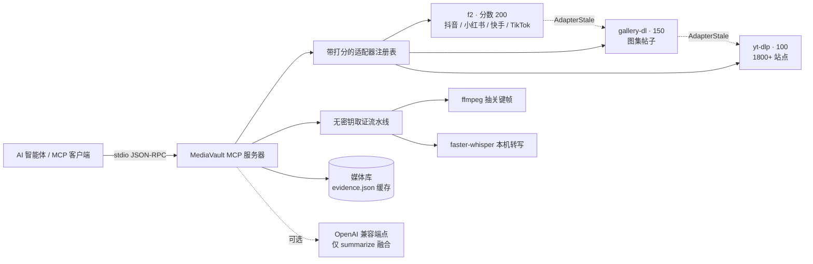

# 🗄️ MediaVault MCP

**[English](README.md)** ｜ **[简体中文](README.zh-CN.md)**

[](https://github.com/Majiturbo/mediavault-mcp/actions/workflows/ci.yml)
[](https://github.com/Majiturbo/mediavault-mcp)
[](https://www.python.org/)
[](https://modelcontextprotocol.io/)
[](LICENSE)
[](CONTRIBUTING.md)

> **粘贴一个链接，拿回原始素材。** 一个本地运行、无需任何 API Key 的 stdio MCP
> 服务器：从 1800+ 平台抓取原生无水印媒体，并把真实的视频证据——逐字稿加关键帧
> 图片——交给你的 AI 智能体，全程不调用第二个大模型。

你的智能体本身就有模型，凭什么一个媒体 MCP 还要再要一把 API Key？MediaVault
在你自己的机器上做确定性的取证工作（yt-dlp / f2 / gallery-dl → ffmpeg → 本地
Whisper），再以 MCP 内容块返回，**让你已经在跑的智能体负责推理**。服务端的
摘要融合只是可选项，永远不是必需项。

## ✨ 为什么选择 MediaVault？

- 🔑 **零 API Key 起步。** `parse_url`、`download`、`analyze` 无需任何密钥，也绝不调用第三方模型。语音用 faster-whisper 在本机转写，关键帧以图片块返回给智能体自己的视觉模型。
- 🛡️ **诚实的无水印声明。** 我们只抓取平台自己的源流，并逐项标注 `native` / `unknown` / `none`。不裁剪、不涂抹、绝不谎称移除了本不存在的水印。
- 🔗 **带打分的适配器回退链。** f2（国内平台优先）→ gallery-dl（图集）→ yt-dlp（1800+ 站点）。某个解析器失效时透明降级，而不是让整个请求失败。
- 🧠 **面向智能体的视频理解。** 一次 `analyze` 同时返回 JSON 证据块（文案、带时间戳的逐字稿、流水线状态）**和每个关键帧对应的图片内容块**——正是具备视觉能力的智能体所需要的。
- 📚 **持久化媒体库。** 每个结果按视频原子化缓存；重复调用自动跳过重复下载和重复转写，需要强刷时传 `refresh=true`。
- 🔒 **本地优先、隐私可控。** Cookie 和代理只留在你的机器上，使用前先校验，绝不写进日志或缓存证据。

## 🧩 工作原理



平台改版时 MCP 工具面完全不动：变化的只有注册表背后的适配器，
`AdapterStale` 会自动沿回退链逐级尝试。

## 🚀 快速开始

需要 Python 3.11+、[uv](https://docs.astral.sh/uv/) 以及 ffmpeg
（macOS 用 `brew install ffmpeg`，Linux 用发行版自带包）。

```bash
git clone https://github.com/Majiturbo/mediavault-mcp.git
cd mediavault-mcp
uv venv --python 3.11
uv pip install -e ".[dev]"
uv pip install -e ".[local-asr]"   # 可选：完全离线的本地语音转写
cp .env.example .env               # 可选：代理 / Cookie / 大模型配置
```

启动 stdio 服务器：

```bash
uv run python -m mediavault
# 或安装后的命令行入口：mediavault
```

在任意 MCP 客户端里以 stdio 方式接入：

```json
{
  "mcpServers": {
    "mediavault": {
      "command": "uv",
      "args": ["--directory", "/abs/path/to/mediavault-mcp",
               "run", "python", "-m", "mediavault"]
    }
  }
}
```

可选后端会在 PATH 上自动探测——两个都不装、只装一个、全装都行：

```bash
pipx install f2           # 抖音 / 小红书 / 快手 / TikTok / 微博 / B站 一等公民支持
pipx install gallery-dl   # 图集帖子（小红书、Instagram、Pinterest、微博）
```

## 🛠️ 七个工具

| 工具 | 输入 | 作用 |
|---|---|---|
| `parse_url` | 分享文案或 URL | 返回归一化元数据，不下载任何字节 |
| `download` | 分享文案或 URL，`quality=compat/quality/speed` | 把原生媒体存到 `MEDIAVAULT_HOME` |
| `analyze` | 分享文案或 URL，`with_media=true`，`refresh=false` | **无需密钥**：JSON 证据 + 关键帧图片块，按视频缓存 |
| `summarize` | 分享文案或 URL，`with_media=true` | 可选的服务端融合摘要任务（需 OpenAI 兼容端点），用 `get_job` 轮询 |
| `get_job` | 任务 id | 轮询任务状态（queued/running/succeeded/failed） |
| `list_jobs` | — | 最近的后台任务，最新在前 |
| `list_library` | — | 列出已缓存的证据 / 摘要 |

所有返回集合的工具都用显式信封 `{"count": n, "results": [...]}` 包装，
因此一次粘贴多个链接也不会悄悄丢数据。`analyze` 是单资源的（图片只属于
那一个视频），并通过 `urls_detected` / `additional_urls` 告诉智能体还有哪些
链接需要再调一次。

## 🌐 平台覆盖

| 平台 | 视频 | 图集 | 首选适配器 |
|---|:---:|:---:|---|
| 抖音、快手 | ✅ | — | f2 → 回退 yt-dlp |
| 小红书 | ✅ | ✅ | f2 → gallery-dl → yt-dlp |
| TikTok、微博、B站 | ✅ | 部分 | f2 → yt-dlp |
| YouTube、X/Twitter、Vimeo、Reddit | ✅ | — | yt-dlp（原生干净流） |
| Instagram、Pinterest | ✅ | ✅ | gallery-dl → yt-dlp |
| yt-dlp 支持的其余 1800+ 站点 | ✅ | 部分 | yt-dlp |

外部 CLI 都是可选的：f2 或 gallery-dl 缺失时，对应适配器抛出
`AdapterStale`，注册表自动继续向下回退——同一个 MCP 调用照常工作。

## 🧠 理解视频的两条路径

**1. `analyze` —— 面向智能体、无需密钥（推荐）。** 确定性取证：
标题 / 作者 / 文案、带时间戳的逐字稿（本地 faster-whisper 或你的 ASR 端点），
以及最多 `MEDIAVAULT_KEYFRAME_MAX` 张降采样后的 JPEG 关键帧，以 MCP 图片块
返回。每个阶段都在 `pipeline` 里诚实上报（`ok` / `off` / `not-configured` /
`extracted` / `skipped-*` / `empty` / `error`）；单个阶段失败绝不会拖垮整个
流程。智能体用自己的模型读逐字稿、看关键帧即可。

**2. `summarize` —— 可选的服务端融合。** 先跑同一套取证，再发起一次
OpenAI 兼容的对话调用，把文案、逐字稿和视觉观察融合成稳定结构（`tldr`、
`chapters`、`entities`、`hooks` 等）。未配置端点时快速失败并给出可操作的
提示——这种情况下用 `analyze` 就对了。

### 完全本地、不碰商业密钥

把所有端点指向本地栈，语音也留在本机：

```bash
OPENAI_BASE_URL=http://localhost:11434/v1   # Ollama / LM Studio / vLLM
OPENAI_API_KEY=ollama                        # 占位即可，本地服务会忽略
MEDIAVAULT_LLM_MODEL=qwen2.5
MEDIAVAULT_VLM_MODEL=llava
MEDIAVAULT_ASR_BACKEND=local                 # faster-whisper，音频不出本机
MEDIAVAULT_WHISPER_MODEL=base
MEDIAVAULT_WHISPER_DEVICE=mps                # CI/Linux 用 cpu · Apple 芯片用 mps · NVIDIA 用 cuda
```

## ⚙️ 配置

所有设置都来自环境变量或 `.env`（完整清单见
[.env.example](.env.example)）。

| 变量 | 默认值 | 用途 |
|---|---|---|
| `MEDIAVAULT_HOME` | `~/MediaVault` | 下载与缓存根目录（`<platform>/<id>/`） |
| `MEDIAVAULT_PROXY` | — | 支持 `http(s)/socks4/socks5/socks5h`；裸 `host:port` 按 HTTP 处理，非法值快速报错 |
| `MEDIAVAULT_COOKIES_FILE` | — | Netscape 格式 cookies.txt，使用前校验，坏路径带告警跳过 |
| `MEDIAVAULT_COOKIES_BROWSER` | — | 复用已登录浏览器（chrome/firefox/...） |
| `MEDIAVAULT_F2_BIN` / `MEDIAVAULT_GALLERYDL_BIN` | `f2` / `gallery-dl` | 覆盖可选 CLI 路径 |
| `MEDIAVAULT_ASR_BACKEND` | `openai` | `openai`（托管）/ `local`（faster-whisper）/ `off` |
| `MEDIAVAULT_WHISPER_MODEL` / `_DEVICE` | `base` / `cpu` | 本地转写模型尺寸与设备（cpu/mps/cuda） |
| `MEDIAVAULT_KEYFRAME_MAX` / `_WIDTH` | `8` / `768` | 关键帧数量上限与降采样宽度 |
| `OPENAI_BASE_URL` / `OPENAI_API_KEY` | OpenAI / — | 仅 `summarize`、托管 ASR 和服务端 VLM 需要 |

下载文件落在 `~/MediaVault/<platform>/<canonical_id>/`，与 `resource.json`、
`evidence.json`（analyze 缓存）和可选的 `summary.json` 并列；媒体任务还会
写出 `audio.wav` 和 `keyframes/` 目录。

## 🧭 设计原则

1. **宿主智能体才是大脑。** MCP 服务器负责取证，而不是背着调用方再租一个大模型。模型调用一律可选。
2. **逐阶段诚实降级。** 每次适配器失败、每个被跳过的媒体阶段、每个被忽略的 Cookie 文件，都会以标记或备注呈现，绝不隐藏。
3. **无水印指的是源头原生，而非“已移除”。** 我们从不裁剪或涂抹；无法核实的流保持 `unknown`。
4. **凭证不出本机。** 不内置第三方解析 Key、无遥测，凭证不进 URL、日志或缓存。
5. **测接缝、模拟外部世界。** 228 个离线测试做到语句与分支 100% 覆盖；真实 ffmpeg 冒烟测试在 ffmpeg 存在时运行，否则自动跳过。

## 🗺️ 路线图

- **下一步：** 面向国内平台的自建 SSR 适配器（对照真实页面结构校准），以及更强的本地模型——说话人分离与更密集的场景检测。
- **长期：** 在平台不断改版的同时，保持适配器链与证据结构稳定。

## 🧪 开发

```bash
.venv/bin/ruff check src tests                          # 代码检查
.venv/bin/python -m pytest -q --cov-fail-under=100      # 离线测试，100% 覆盖门槛
uv build                                                # 构建 wheel 与 sdist
```

CI 在 Ubuntu/macOS × Python 3.11/3.12 上跑同样三项检查。适配器契约与覆盖
策略见 [CONTRIBUTING.md](CONTRIBUTING.md)，发布历史见
[CHANGELOG.md](CHANGELOG.md)，漏洞上报见 [SECURITY.md](SECURITY.md)。

## ⚖️ 许可证

[MIT](LICENSE)。仅处理公开可访问的内容，请遵守各平台服务条款与相关版权
法律，下载内容仅供个人学习使用。本项目不做任何 DRM 绕过。
